# Urban Store · web_2_integrador_final

**E-commerce SPA en React con roles, rutas protegidas y API REST**
Trabajo Práctico Integrador Final · Desarrollo Web 2
UNTDF · Tecnicatura Universitaria en Desarrollo de Aplicaciones
📅 Entrega: **03/11/2026**

---

## 👥 Integrantes

| Integrante | Rol en el proyecto |
|---|---|
| **Prado Alejandro** | B: Lógica, datos, sesión y administración |
| **Castro Carrillo Abril** | A: Tienda, interfaz pública y carrito |

---

## 🧩 División de responsabilidades

### Parte A: Tienda (Castro Carrillo Abril)
- Componentes de interfaz: `Navbar`, `Footer`, `ProductCard`, `Loader`, `ErrorMessage`.
- **Home** (`/`): categorías visibles, secciones por tags (Promoción, Orgánico, etc.), tarjetas y búsqueda.
- **Catálogo** (`/productos`): filtros combinables por categoría y tag, búsqueda textual, orden por precio y estados de carga, error y vacío.
- **Detalle** (`/productos/:id`): información e imágenes; la compra exige iniciar sesión.
- **CartContext**: agregar, quitar y cambiar cantidades, subtotal y persistencia en `localStorage`.
- **Carrito** (`/carrito`) y **Checkout** (`/checkout`) con compra simulada.
- Casos de prueba de compra y persistencia del carrito.

### Parte B: Lógica, datos y administración (Prado Alejandro)
- **Servicios** (`apiClient`, `productService`, `categoryService`, `tagService`, `authService`):
  - `fetch` con `async/await`, `try/catch` y control de `response.ok`.
  - Distinción de errores de red, 401/403 y 404.
  - Normalización de productos, categorías y tags.
  - Escrituras (`POST`, `PUT`, `DELETE`) y subida de imágenes contra la API real.
  - Validación del rol y de los datos en la capa de servicio antes de cada escritura.
- **AuthContext**, cuentas demo y pantalla de **Login** (`/login`).
- **ProtectedRoute**, **AdminRoute** y las páginas `/403` y 404.
- **Panel de administración** (`/admin/*`): CRUD de productos, categorías y tags, con tablas, formularios, validaciones, subida de imágenes y confirmación antes de borrar.
- Resolución de referencias y dependencias (por ejemplo, eliminar una categoría con productos asociados).
- Casos de prueba de acceso, CRUD y fallas de red.

### Tareas compartidas
- Estructura base del proyecto y definición de rutas en `App.jsx`.
- Contrato de los servicios (nombres y retornos de las funciones) y de `useAuth()`.
- Integración final, pruebas, documentación y video.

---

## 🛠️ Tecnologías

| Tecnología | Uso |
|---|---|
| [React 19](https://react.dev/) | Componentes funcionales, props, state y hooks |
| [Vite 8](https://vite.dev/) | Entorno de desarrollo y build |
| [React Router 7](https://reactrouter.com/) | Navegación SPA, rutas dinámicas y protegidas |
| [Tailwind CSS 4](https://tailwindcss.com/) | Estilos |
| Context API | Sesión (`AuthContext`) y carrito (`CartContext`) |
| `fetch` + `async/await` | Consultas asincrónicas a los datos |
| Proxy de Vite | Reenvía `/api/*` a la API de la cátedra agregando el token del lado del servidor |
| `localStorage` | Carrito y sesión simulada (nunca secretos) |
| [ESLint 9](https://eslint.org/) | Calidad de código: `eqeqeq`, `jsx-key`, reglas de Hooks y variables sin usar |

---

## 🚀 Instalación y ejecución

**Requisitos:** Node.js 20 o superior y npm.

```bash
# 1. Clonar el repositorio
git clone https://github.com/Bellcebu/web_2_integrador_final.git
cd web_2_integrador_final

# 2. Instalar dependencias
npm install

# 3. Crear el archivo .env a partir de la plantilla y completar API_TOKEN
cp .env.example .env

# 4. Levantar el servidor de desarrollo
npm run dev
```

La aplicación queda disponible en `http://localhost:5173`.

### Variables de entorno (`.env`)

| Variable | Descripción |
|---|---|
| `API_URL` | URL de la API de la cátedra (por defecto `https://ecommerce.fedegonzalez.com`) |
| `API_TOKEN` | La API de prueba acepta cualquier token: el del equipo lo comparte el grupo por privado. **No está en el repositorio.** |

- El archivo `.env` está en `.gitignore` y **nunca se sube**; el repositorio solo incluye `.env.example` con `API_TOKEN` vacío.
- Las variables **no llevan el prefijo `VITE_`** a propósito: Vite solo expone al navegador las variables `VITE_*`, así que `API_TOKEN` queda únicamente en el proceso de Node que corre el servidor.
- Si se cambia el `.env`, hay que reiniciar `npm run dev`. Si falta `API_TOKEN`, la terminal muestra un aviso.

| Script | Descripción |
|---|---|
| `npm run dev` | Servidor de desarrollo |
| `npm run build` | Build de producción en `dist/` |
| `npm run preview` | Previsualiza el build |
| `npm run lint` | Análisis estático con ESLint |
| `npm run lint:fix` | Corrige automáticamente lo que ESLint puede arreglar |

---

## 🔐 Cuentas demo y permisos

> ⚠️ Son **cuentas de demostración ficticias**, definidas solo para la práctica. No son credenciales reales.

| Rol | Usuario | Contraseña |
|---|---|---|
| Administrador | `admin` | `admin123` |
| Cliente | `cliente` | `cliente123` |
| Visitante | (sin sesión) | — |

- Las cuentas están definidas en `src/services/authService.js` y la pantalla de login las muestra para completarlas con un clic.
- La sesión es **simulada**: se guarda solo el `username` en `localStorage` (nunca la contraseña) y el rol se vuelve a leer de las cuentas demo al recargar, así que editar `localStorage` a mano no da permisos de admin.
- Además de proteger rutas y botones, los servicios validan el rol (`exigirAdmin()`) antes de cada operación de escritura.
- **Esto no reemplaza la autorización de un servidor**: el código del frontend es visible para cualquiera, por lo que la protección del CRUD es una simulación.

### Matriz de permisos

| Acción | Visitante | Cliente | Admin |
|---|:---:|:---:|:---:|
| Ver catálogo y detalle | ✅ | ✅ | ✅ |
| Buscar y filtrar | ✅ | ✅ | ✅ |
| Agregar al carrito / comprar | 🔒 Login requerido | ✅ | ✅ |
| CRUD productos | ❌ | ❌ | ✅ |
| CRUD categorías | ❌ | ❌ | ✅ |
| CRUD tags | ❌ | ❌ | ✅ |

### Rutas

| Ruta | Acceso |
|---|---|
| `/` | Público |
| `/productos` | Público |
| `/productos/:id` | Público |
| `/login` | Público |
| `/carrito` | Requiere sesión (`ProtectedRoute`) |
| `/checkout` | Requiere sesión (`ProtectedRoute`) |
| `/admin` | Solo admin (`AdminRoute`); redirige a `/admin/productos` |
| `/admin/productos` | Solo admin (`AdminRoute`) |
| `/admin/categorias` | Solo admin (`AdminRoute`) |
| `/admin/tags` | Solo admin (`AdminRoute`) |
| `/403` | Acceso denegado |
| `*` | 404: página no encontrada |

Un visitante que intenta entrar a una ruta protegida se redirige a `/login`. Un usuario sin rol admin que intenta entrar a `/admin/*` se redirige a `/403`.

---

## 🗂️ Origen de datos

Los datos vienen de la **API REST de la cátedra** ([documentación](https://ecommerce.fedegonzalez.com/docs)) a través de un **proxy de Vite** que funciona como backend intermediario:

```
Navegador (React) ──► /api/products/ ──► Proxy de Vite (agrega el token) ──► https://ecommerce.fedegonzalez.com/products/
```

- El frontend **nunca conoce el token**: todas las peticiones van a `/api/...` y el proxy (`vite.config.js`) agrega el header `Authorization: Bearer <API_TOKEN>` leyendo el `.env`.
- Así se cumple que el token no esté en el código de React, en variables `VITE_*` ni en el repositorio.
- **Limitación:** el proxy solo existe mientras corre `npm run dev` o `npm run preview`. Si se sube `dist/` a un hosting estático, haría falta un backend real que cumpla la misma función.
- Las operaciones de escritura (crear, editar, borrar) se hacen contra la API real, por lo que los cambios persisten al recargar.
- El token es compartido por el equipo: todos los que lo usan ven y modifican los mismos datos.

### Capa de servicios
- `apiClient.js` centraliza el `fetch`: controla `response.ok`, usa `try/catch` y distingue error de red, 401/403, 404, 422 (datos inválidos) y errores del servidor con mensajes comprensibles.
- Acepta un `AbortController` (`signal`) para cancelar peticiones cuando un componente se desmonta y evitar solicitudes duplicadas.
- Los servicios **normalizan** las respuestas para que los componentes siempre reciban la misma forma; por ejemplo, convierten las rutas de imágenes (`/uploads/...`) en URLs completas.
- Los IDs se validan antes de consultar la API (por ejemplo `/productos/abc` responde "no encontrado" sin hacer la petición).
- La API solo filtra productos por categoría; la búsqueda por texto, el filtro por tags y el orden por precio se hacen en el frontend.

### Modelo de datos
- **Producto:** `id`, `title`, `description`, `price`, `category_id`, `pictures`, `category`, `tags`.
- **Categoría:** `id`, `title`, `description`, `picture`.
- **Tag:** `id`, `title`.

Cada producto referencia **una categoría** (obligatoria en el formulario) y **cero o más tags**.

### Referencias, edición y eliminación con dependencias

**Referencias:** el producto guarda `category_id` y la API devuelve además la `category` y los `tags` completos dentro de cada producto. El frontend no tiene que cruzar listas para mostrarlos. En el panel admin se cargan las tres listas juntas para poder contar cuántos productos usa cada categoría y cada tag.

**Edición:** al editar un producto se envían `category_id` y `tag_ids` (la lista completa de tags elegidos). Así se cambian la categoría y los tags en una sola operación.

**Eliminación:** comportamiento verificado contra la API.

| Se elimina… | Qué hace la API | Regla de la app |
|---|---|---|
| Una **categoría** con productos | La borra y deja a sus productos **sin categoría** (`category_id: null`) | **No se permite**: el botón "Eliminar" queda deshabilitado e indica cuántos productos tiene. Primero hay que mover esos productos a otra categoría. |
| Un **tag** usado por productos | Lo borra y lo **quita de los productos** que lo tenían | **Se permite**: la confirmación avisa a cuántos productos afecta. |
| Un **producto** que está en un carrito | Lo borra | Al entrar al Carrito o al Checkout se compara con el catálogo: los productos borrados se quitan y los precios cambiados se actualizan, con un aviso al usuario. |

### Imágenes de productos
- Se suben desde el formulario del producto (`POST /products/{id}/pictures`, multipart) y **se suman** a las que ya tiene. La API no permite borrarlas.
- La API acepta cualquier archivo (incluso un `.txt`), así que el frontend valida que sea **JPG, PNG, WEBP o GIF de hasta 5 MB**.

### Tags especiales del Home
- Los productos con el tag **"Destacado"** aparecen en el carrusel del Home.
- Los productos con el tag **"Oferta"** o **"Promoción"** aparecen en la sección Ofertas.
- Si ningún producto tiene esos tags, esas secciones no se muestran. Los tags se crean y se asignan desde el panel admin.

---

## 📁 Estructura del proyecto

```
src/
├── components/      Layout, Navbar, Footer, ProductCard, Carrusel, Estrella, Loader, ErrorMessage,
│   │                ProtectedRoute, AdminRoute
│   └── admin/       AdminNav, Modal, Campo, Aviso, BotonEliminar, estilos
├── pages/           Home, Products, ProductDetail, Login, Cart, Checkout, Forbidden, NotFound
│   └── admin/       AdminProducts, AdminCategories, AdminTags
├── context/         AuthContext, CartContext + useCart, ThemeContext + useTema
├── hooks/           useDatosAdmin, useSincronizarCarrito
├── services/        apiClient, authService, productService, categoryService, tagService,
│                    validaciones, tagsEspeciales
├── assets/          Fondos claro y oscuro
├── App.jsx          Definición de rutas
├── main.jsx         Punto de entrada
└── index.css        Tailwind y colores del tema
```

- **`services/`**: solo llamadas a la API y validaciones, sin React.
- **`hooks/`**: lógica reutilizable con estado de React.
- **`context/`**: estado global (sesión, carrito, tema).

---

## ✅ Casos de prueba

Pruebas manuales realizadas con `npm run dev`, datos reales de la API y las cuentas demo.

### Parte A: Tienda y carrito

| # | Caso | Pasos | Resultado esperado | Resultado obtenido |
|---|---|---|---|---|
| A1 | Visitante intenta comprar | Sin sesión, entrar a un producto y tocar "Iniciá sesión para comprar" | Redirige a `/login` y, al iniciar sesión, vuelve al mismo producto | ✅ Redirige a `/login` con el aviso "Necesitás iniciar sesión para continuar"; después del login vuelve a `/productos/:id` |
| A2 | Cliente agrega artículos y confirma la compra | Como cliente: Detalle → "Agregar al carrito" → Carrito → "Ir a pagar" → "Confirmar compra" | El contador del Navbar sube; el Checkout muestra el resumen y el total; al confirmar aparece el agradecimiento y el carrito queda vacío | ✅ Contador en 1, resumen y total correctos, mensaje "¡Gracias por tu compra!" y carrito vacío (también en `localStorage`) |
| A3 | Recargar la página conserva el carrito | Agregar productos y recargar con F5 | El carrito y el contador siguen igual | ✅ Se conserva: el carrito se guarda en `localStorage` y se lee al iniciar |
| A4 | Cambiar cantidades en el carrito | En `/carrito`, tocar "+" y después "−" hasta 0 | "+" suma y recalcula el total; al llegar a 0 el producto se quita | ✅ Con 2 unidades el total se duplicó; al llegar a 0 se mostró "Tu carrito está vacío" |
| A5 | Filtros combinables en el catálogo | En `/productos`, elegir categoría "Remeras" y orden "Mayor precio" | Solo remeras, de mayor a menor precio | ✅ 2 de 13 productos, ordenados de mayor a menor |
| A6 | Búsqueda sin resultados | En `/productos`, buscar "zapatilla" | Mensaje de estado vacío | ✅ "No hay productos que coincidan con los filtros." |
| A7 | Producto inexistente | Entrar a `/productos/99999` | Mensaje de producto no encontrado, sin botón Reintentar | ✅ "Producto no encontrado." con link para volver al catálogo |
| A8 | Navegación desde el Home | En `/`, tocar una categoría y usar el buscador | Abre el catálogo con el filtro ya aplicado | ✅ "Camperas" abre `/productos?categoria=359` (2 productos); buscar "jean" abre `/productos?buscar=jean` (2 productos) |

### Parte B: Acceso, administración y errores

| # | Caso | Pasos | Resultado esperado | Resultado obtenido |
|---|---|---|---|---|
| B1 | Visitante intenta entrar a `/admin` | Sin sesión, ir a `/admin` | Redirige a `/login` y, al iniciar sesión, vuelve a la ruta pedida | ✅ Redirige a `/login`; al entrar como cliente vuelve a `/admin` y termina en `/403` (B2) |
| B2 | Cliente intenta acceder a `/admin/productos` | Con sesión de cliente, ir a `/admin/productos` | Pantalla de acceso denegado | ✅ Redirige a `/403` "Acceso denegado"; el link "Administración" no aparece en su menú |
| B3 | Admin crea un producto (validaciones) | `/admin/productos` → "+ Nuevo producto" → "Guardar" con el formulario vacío; después completar los datos y una imagen | Primero, mensajes de campos obligatorios; después, producto creado con su imagen | ✅ Marca nombre, descripción, precio y categoría como obligatorios; al completar muestra "Producto "BUZO DEMO" creado." y aparece en la tabla con la imagen |
| B4 | Se cambian la categoría y los tags de un producto | "Editar" → cambiar categoría de Remeras a Buzos y marcar el tag "Oferta" → "Guardar" | El producto queda con la nueva categoría y el tag | ✅ "Producto actualizado."; en la tabla figura en Buzos con el tag Oferta |
| B5 | Admin borra un producto | "Eliminar" → confirmar con "Sí" | Pide confirmación y lo borra | ✅ Muestra "¿Eliminar? Sí / No"; al confirmar, "Producto eliminado." y desaparece de la tabla |
| B6 | Se elimina una categoría con productos | `/admin/categorias`, intentar eliminar "Pantalones" | No se permite y se explica por qué | ✅ Botón deshabilitado: "Tiene 3 producto(s). Movelos a otra categoría antes de eliminarla." |
| B7 | Se elimina un tag usado por productos | `/admin/tags` → "Eliminar" en "Oferta" | La confirmación avisa a cuántos productos afecta | ✅ "¿Eliminar? Se quita de 3 producto(s)." (se canceló con "No") |
| B8 | Falla el fetch | Cortar la conexión con la API y abrir `/productos` | Mensaje comprensible y botón para reintentar | ✅ "No se pudo conectar con el servidor. Revisá tu conexión a internet." con botón "Reintentar" |
| B9 | Recarga de página conserva cambios y sesión | Como admin, crear o editar algo y recargar con F5 | La sesión sigue y los cambios siguen (están en la API) | ✅ Sigue en `/admin/productos` como "Administrador" y los cambios se mantienen |
| B10 | Imagen inválida | En el formulario de producto, elegir un archivo `.txt` | Se rechaza antes de enviarlo | ✅ ""no-imagen.txt" no es una imagen (JPG, PNG, WEBP o GIF)." |
| B11 | Nombre repetido | Crear una categoría llamada "remeras" | No se permite el duplicado | ✅ "Ya existe una categoría con ese nombre." |
| B12 | ID inválido | Entrar a `/productos/abc` | "No encontrado" sin consultar la API | ✅ "Producto no encontrado." y ninguna petición a `/products/abc` |

---

## 📸 Capturas y video

### Video: cliente compra
Visitante entra a `/admin` → login como cliente → acceso denegado → catálogo filtrado → detalle → carrito → compra confirmada.


### Video: admin CRUD
Validaciones → crear producto con imagen → cambiar categoría y tags → eliminar con confirmación.


Versiones en MP4: [`video-cliente-compra.mp4`](docs/capturas/video-cliente-compra.mp4) · [`video-admin-crud.mp4`](docs/capturas/video-admin-crud.mp4)

### Tienda

| Home | Home (tema oscuro) |
|---|---|
| 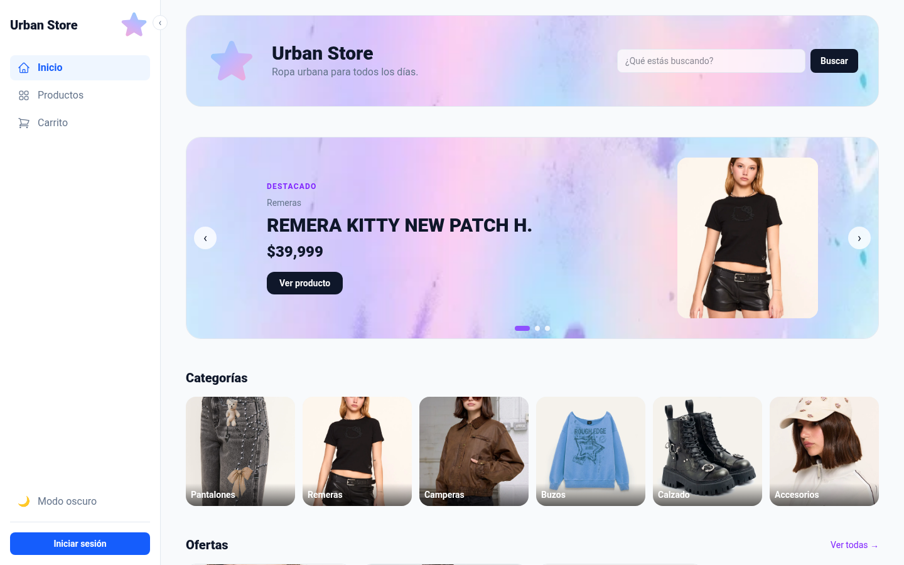 | 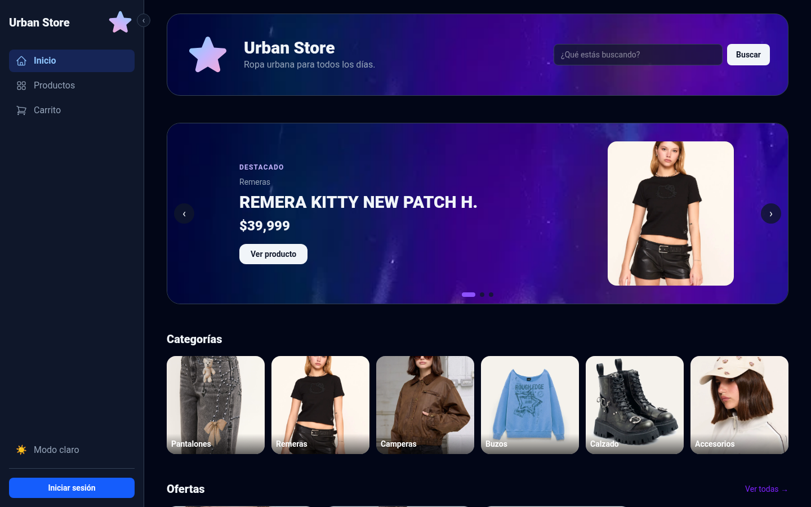 |
| **Catálogo con filtros** | **Detalle (visitante)** |
| 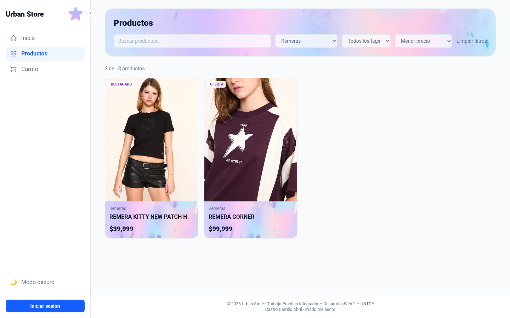 | 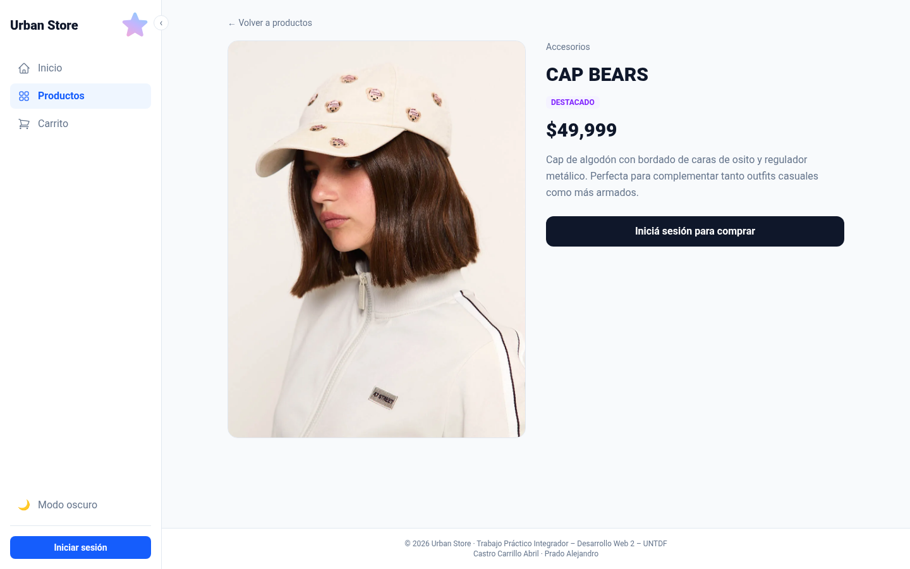 |
| **Carrito** | **Checkout** |
| 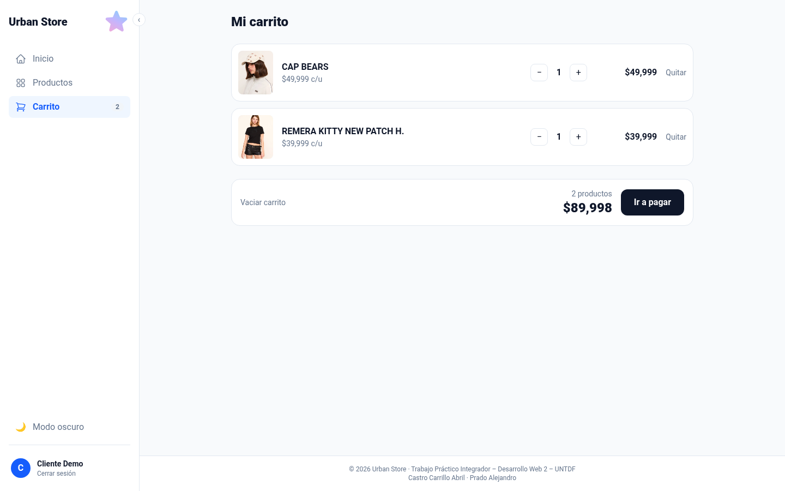 | 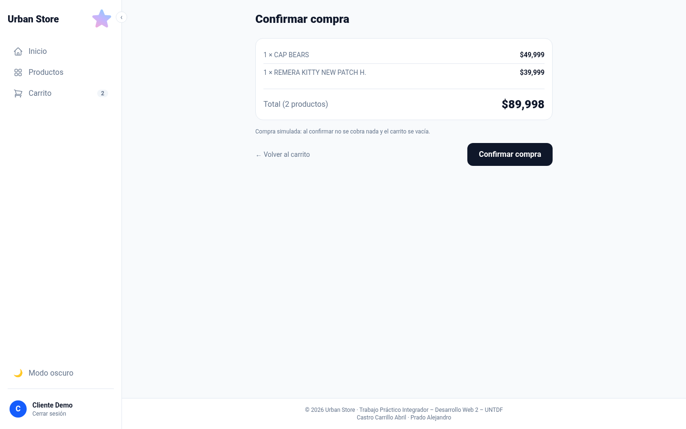 |
| **Compra confirmada** | **Login (al intentar entrar a /admin)** |
| 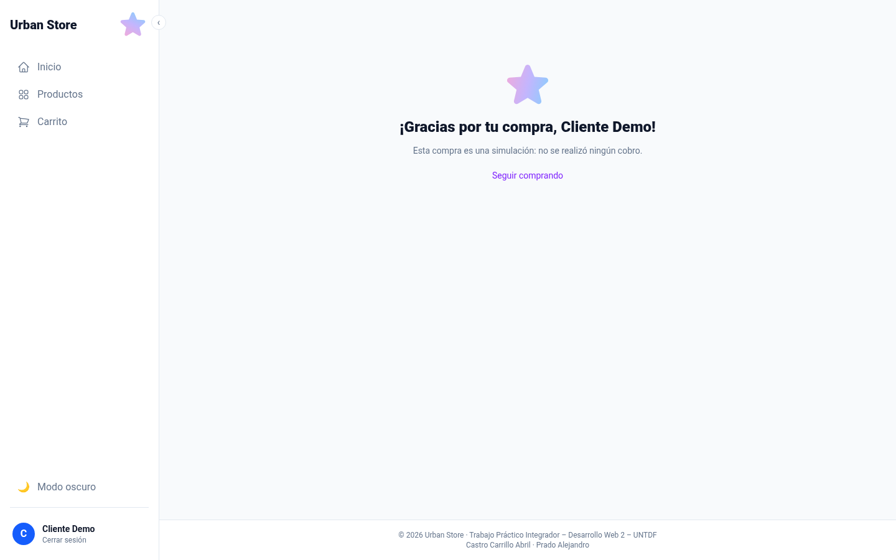 | 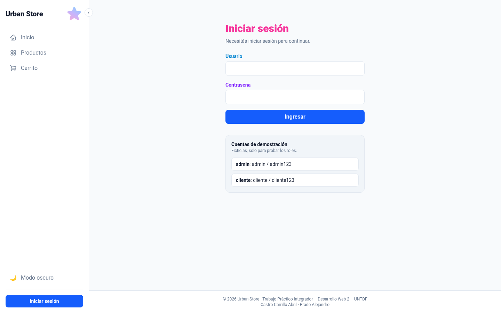 |

### Administración

| Productos | Validaciones del formulario |
|---|---|
| 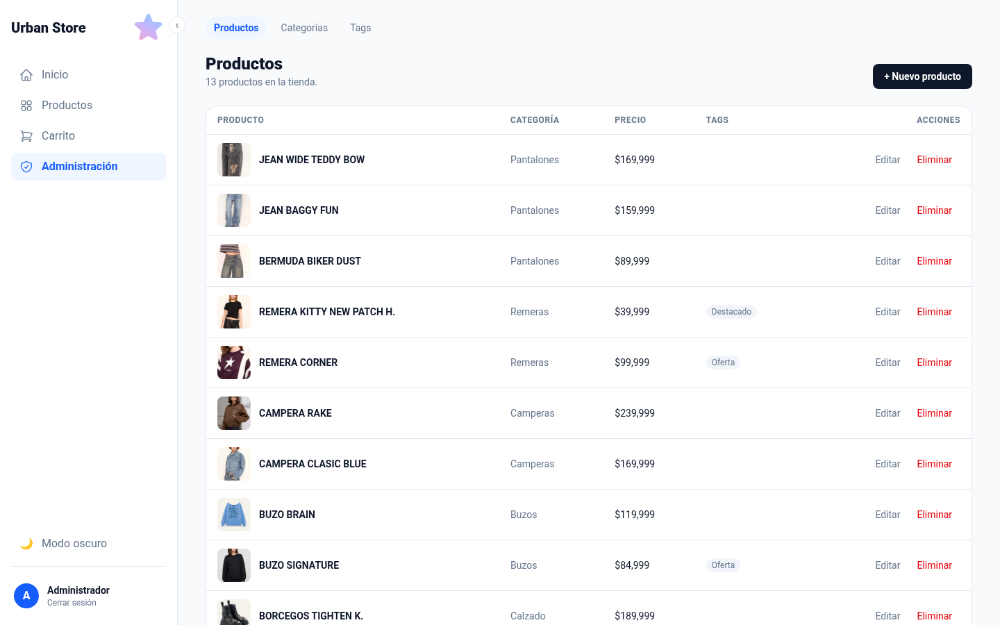 | 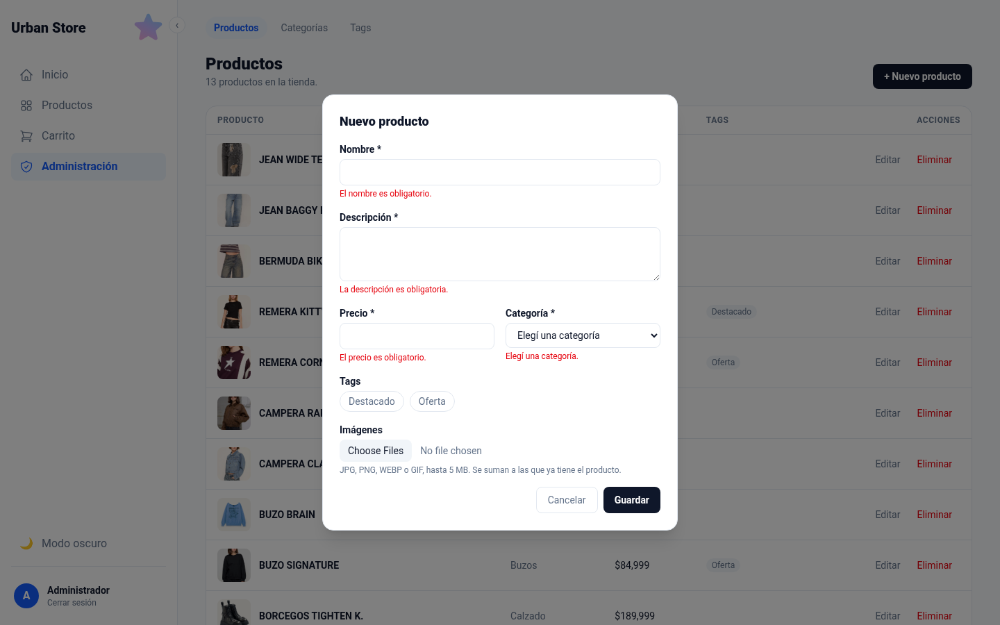 |
| **Editar producto** | **Categorías (no se borran si tienen productos)** |
| 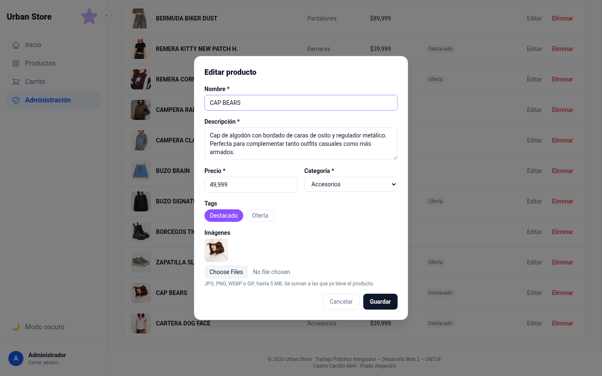 | 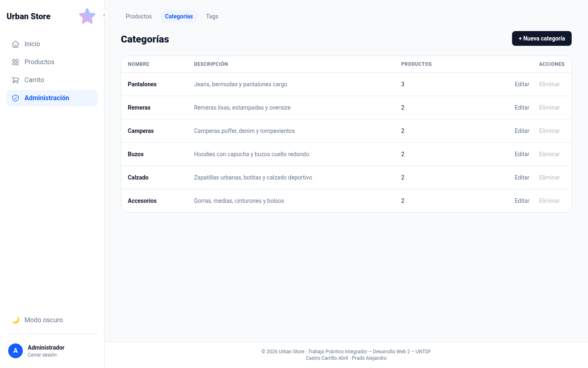 |
| **Confirmación al borrar un tag** | |
| 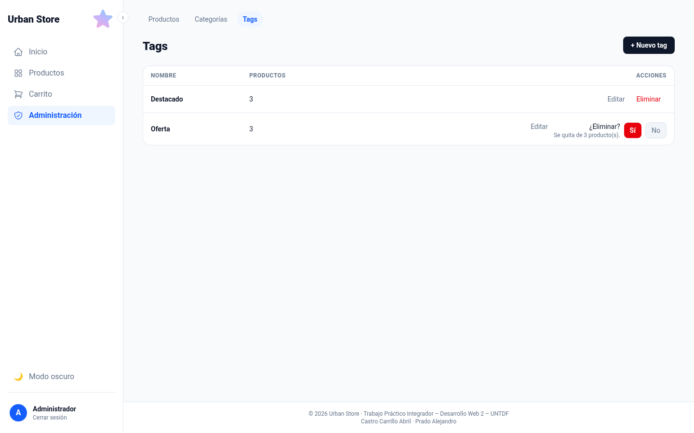 | |

### Errores y accesos

| 403: cliente en `/admin/productos` | 404 | Falla de red |
|---|---|---|
| 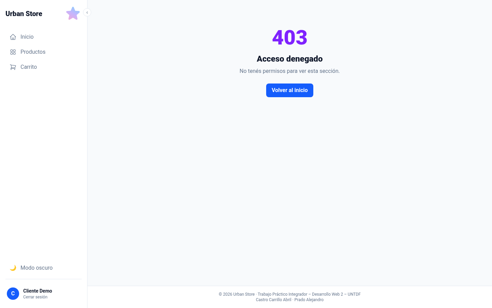 | 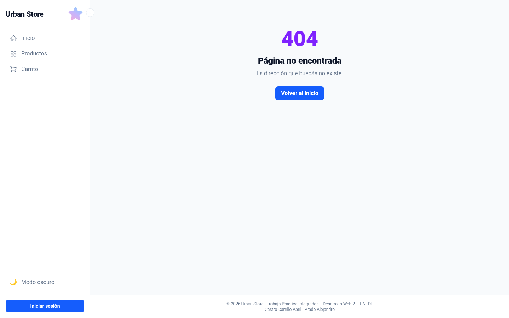 | 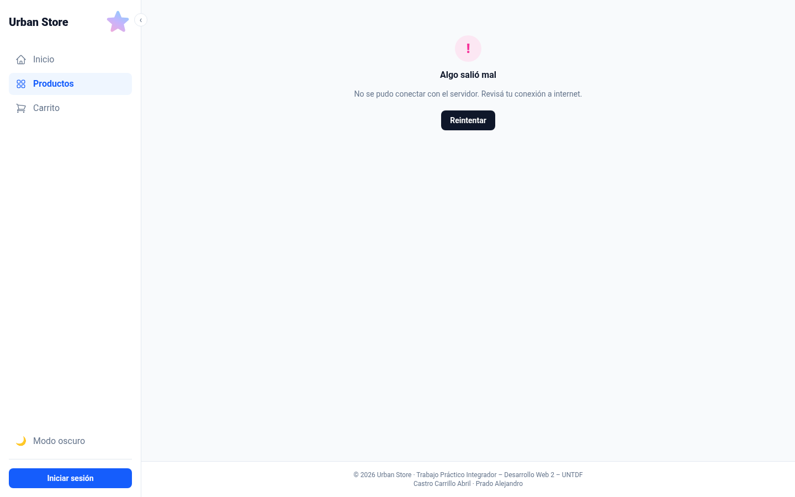 |

---

